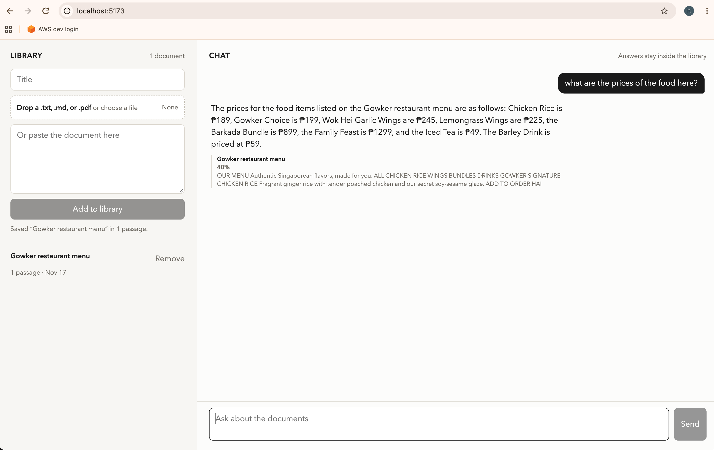
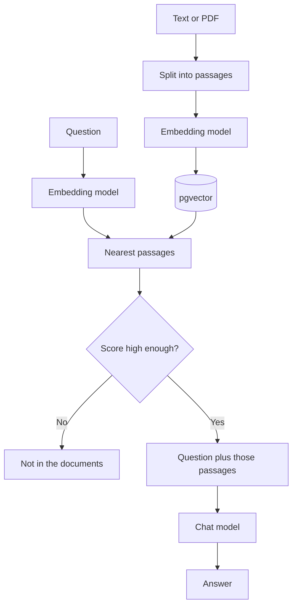

# RAG chat



A small proof of concept / MVP app that answers questions from your own documents. A React UI (`apps/web`, port 5173) talks to a Nest API (`apps/api`, port 3002). The API does not load model weights. It calls two [llama.cpp](https://github.com/ggml-org/llama.cpp) servers, and stores text plus vectors in Postgres with [pgvector](https://github.com/pgvector/pgvector).

## What RAG is

Retrieval-augmented generation means the chat model is not asked to remember your files. On each question the app:

1. Turns the question into a vector (an embedding).
2. Finds the nearest stored passages by cosine distance.
3. Puts those passages in the prompt.
4. Asks the chat model to answer from that text only.

If nothing scores well enough, the API says it cannot find the answer. It does not fall back to the model's general knowledge.



In this repo that looks like:

- Upload a `.txt`, `.md`, or `.pdf`, or paste text. PDFs are read with `unpdf` (text layer only).
- Split the text into overlapping passages of about 1,400 characters.
- Embed each passage and insert it into `chunks.embedding` (`halfvec(2560)`), indexed with HNSW.
- On a question, embed it, take the top 5 chunks, keep the ones close to the best score, and stream a completion.

## Qwen and the "4B"

[Qwen](https://qwenlm.github.io/) is Alibaba's family of open-weight models. This project uses two of them, because embedding and chat are different jobs:

| File | Role | Port |
| --- | --- | --- |
| [`Qwen3-Embedding-4B-Q6_K.gguf`](https://huggingface.co/Qwen/Qwen3-Embedding-4B-GGUF/blob/main/Qwen3-Embedding-4B-Q6_K.gguf) | Turns text into a 2560-number vector | 8081 |
| [`Qwen3.5-4B-Q4_K_M.gguf`](https://huggingface.co/ggml-org/Qwen3.5-4B-GGUF/blob/main/Qwen3.5-4B-Q4_K_M.gguf) | Writes the answer from the retrieved passages | 8080 |

The **B** is billions of parameters: the count of learned weights. **4B** is about 4 billion weights. That count is what sets memory and speed. A 4B model is small enough to run on a laptop CPU or an Apple GPU. Quality is below 30B-class models, which is the tradeoff for fitting both servers on one machine.

Uncompressed, 4 billion weights at 16-bit are about 8 GB each. The suffix after the size is the quantization, which stores those weights in fewer bits:

- `Q4_K_M` is about 4-bit. The chat file is about 3.0 GB. Generation can tolerate that loss.
- `Q6_K` is about 6-bit. The embedding file is about 3.3 GB. Retrieval is pickier, so the vectors stay closer to the original model.

Plan on about **8–12 GB of free RAM** for both processes, plus Postgres. A 16 GB machine is a practical minimum. On an 8 GB machine the servers will swap or fail to load.

## Why GGUF

GGUF is the file format [llama.cpp](https://github.com/ggml-org/llama.cpp) runs. The quantized weights, vocabulary, and model settings live in one file, so you do not need a PyTorch or CUDA install to serve the model. [`llama-server`](https://github.com/ggml-org/llama.cpp/blob/master/tools/server/README.md) exposes an OpenAI-compatible HTTP API. This app only needs that:

- `POST /v1/embeddings` on port 8081
- `POST /v1/chat/completions` (streamed) on port 8080

One `llama-server` process loads one GGUF, so the two models run as separate processes. URLs are `LLM_BASE_URL` and `EMBED_BASE_URL` in `apps/api/.env`.

The API expects embedding length **2560**. A different embedding model will be rejected. Queries are embedded with an instruction prefix (`Instruct: … / Query: …`); stored passages are embedded as raw text. That split is required by Qwen3-Embedding.

## Run the models

Install [llama.cpp](https://github.com/ggml-org/llama.cpp) ([build instructions](https://github.com/ggml-org/llama.cpp/blob/master/docs/build.md)) and use its [`llama-server`](https://github.com/ggml-org/llama.cpp/blob/master/tools/server/README.md) binary. Download [Qwen3-Embedding-4B-Q6_K.gguf](https://huggingface.co/Qwen/Qwen3-Embedding-4B-GGUF/blob/main/Qwen3-Embedding-4B-Q6_K.gguf) and [Qwen3.5-4B-Q4_K_M.gguf](https://huggingface.co/ggml-org/Qwen3.5-4B-GGUF/blob/main/Qwen3.5-4B-Q4_K_M.gguf), then start each in its own terminal:

```bash
# chat
llama-server -m Qwen3.5-4B-Q4_K_M.gguf --port 8080 -c 8192 -ngl 99

# embeddings
llama-server -m Qwen3-Embedding-4B-Q6_K.gguf --port 8081 --embeddings -c 8192 -ngl 99
```

`-ngl 99` moves layers onto the GPU when the binary was built with Metal or CUDA. Drop it to run on CPU only. `--embeddings` puts that server in embedding mode so `/v1/embeddings` works.

## Run the app

Stock Postgres has no vector type, so install [pgvector](https://github.com/pgvector/pgvector#installation) on the same server `DATABASE_URL` points at. The shared library has to be built for that Postgres major version. The install page covers Homebrew, apt, Postgres.app, Docker, and building from source. This app stores embeddings as `halfvec(2560)`, which needs pgvector 0.7 or newer.

With the library on the server, enable it in the app database:

```sql
CREATE EXTENSION vector;
```

The API runs that on startup (`CREATE EXTENSION IF NOT EXISTS vector`) and then creates `documents` and `chunks`. If the library is missing, startup fails before any tables exist.

```bash
cp apps/api/.env.example apps/api/.env
pnpm install
pnpm dev
```

Open `http://localhost:5173`. The API listens on port 3002.

## Limits

For now, images are ignored. PDF import reads embedded text, not pixels, so a scanned page comes through empty. Reading those needs an OCR step (Tesseract or similar) before chunking.
